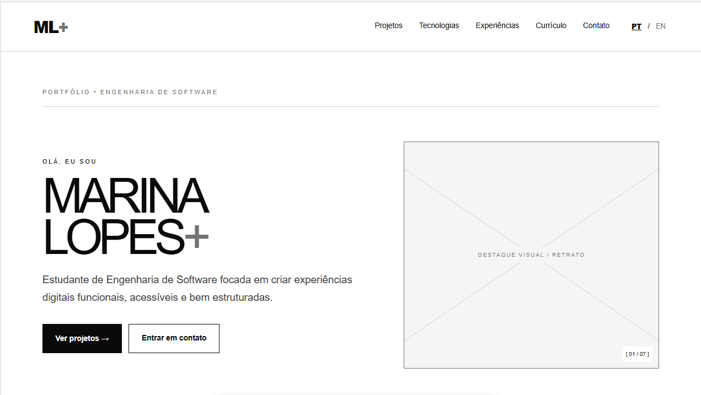
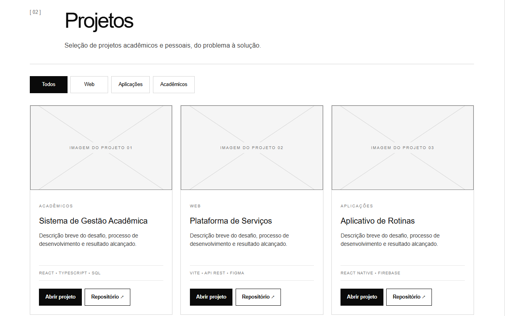
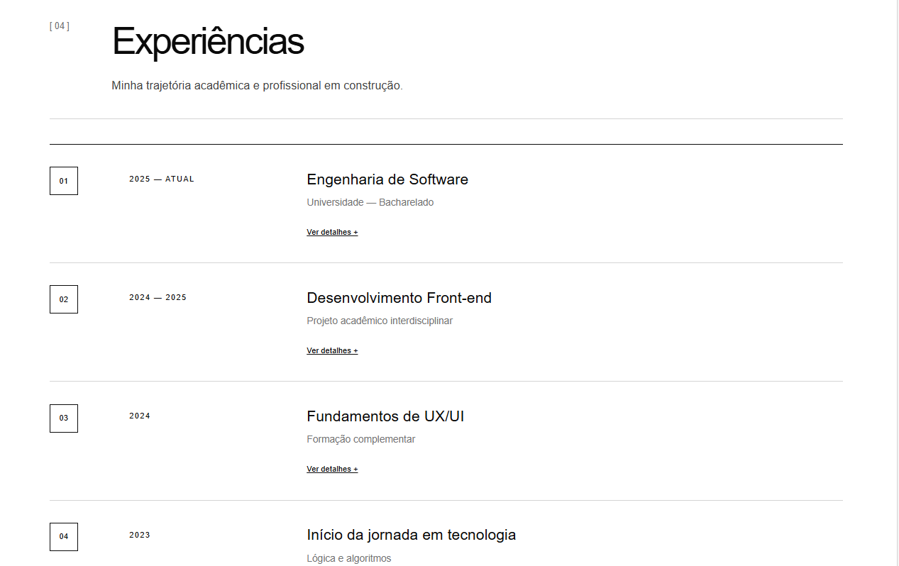

# ML+ | Portfólio Pessoal

Portfólio pessoal desenvolvido como atividade acadêmica do curso de **Engenharia de Software da Pontifícia Universidade Católica de Minas Gerais (PUC Minas)**.

O projeto tem como objetivo apresentar minha trajetória acadêmica, experiências, conhecimentos técnicos e projetos desenvolvidos na área de tecnologia, por meio de uma aplicação web interativa e responsiva.

## 1. Sobre o projeto

O **ML+** foi desenvolvido utilizando React, TypeScript e Vite, com uma identidade visual inspirada em interfaces cinematográficas.

O portfólio reúne informações pessoais e profissionais, projetos, experiências, tecnologias e canais de contato.

### Funcionalidades

- **Sobre mim:** apresentação pessoal em português e inglês.
- **Projetos:** apresentação de projetos com filtros por categoria, descrições, tecnologias e links.
- **Experiências:** informações sobre a trajetória acadêmica e profissional.
- **Tecnologias:** visualização interativa das linguagens e ferramentas utilizadas.
- **Currículo:** acesso às informações profissionais.
- **Contato:** formulário de contato e links para redes profissionais.
- **Filmes & Séries:** catálogo integrado ao Letterboxd.
- **Responsividade:** adaptação da interface a diferentes dispositivos.

## 2. Planejamento e prototipação

Na etapa inicial, foram desenvolvidos wireframes de média fidelidade no Figma para representar a estrutura das páginas e a organização dos elementos de interface.

### Wireframes

**Página inicial**



**Projetos**



**Experiências**



### Protótipo

O protótipo foi utilizado como referência para a implementação da navegação, dos componentes e da identidade visual.

**Figma:** [Acessar protótipo](https://www.figma.com/make/tS9FckwRvdJ5hya5RgUu9B/Portfolio-design-with-colors?fullscreen=1&t=cOxLKjNAK7YaATts-1&code-node-id=0-6)

## 3. Tecnologias utilizadas

| Tecnologia | Finalidade |
|---|---|
| React | Desenvolvimento dos componentes |
| TypeScript | Tipagem e organização do código |
| JavaScript | Funcionalidades e integrações |
| HTML5 | Estrutura da interface |
| CSS3 | Estilização e responsividade |
| Vite | Ambiente de desenvolvimento |
| Vercel | Hospedagem e funções serverless |
| Git e GitHub | Versionamento do projeto |
| Figma | Wireframes e prototipação |

## 4. Dependências e bibliotecas

O projeto utiliza bibliotecas para construção da interface, gerenciamento de estados, integração com serviços externos e processamento de dados.

Entre as principais estão:

- **React e React DOM:** renderização da aplicação.
- **TypeScript:** desenvolvimento com tipagem estática.
- **Vite:** servidor de desenvolvimento e build.
- **fast-xml-parser:** processamento do feed RSS do Letterboxd.

As versões e demais dependências estão disponíveis no arquivo `package.json`.

## 5. Estrutura de diretórios

Organização geral dos principais arquivos e diretórios da aplicação:

```text
portifolio-mayra/
├── api/
│   └── letterboxd.js
├── public/
│   └── images/
├── src/
│   ├── components/
│   ├── contexts/
│   ├── data/
│   ├── App.tsx
│   └── main.tsx
├── index.html
├── package.json
├── package-lock.json
├── vite.config.ts
└── README.md
```

- `api/`: funções serverless e integrações.
- `public/`: imagens e arquivos estáticos.
- `src/components/`: componentes da interface.
- `src/contexts/`: gerenciamento de contexto e idioma.
- `src/data/`: informações utilizadas pelas seções.
- `App.tsx`: organização principal da aplicação.
- `main.tsx`: inicialização do React.

## 6. Instalação e execução

### Pré-requisitos

- Node.js;
- npm;
- Git.

### Clonar o repositório

```bash
git clone https://github.com/MayraSantos06/portifolio-mayra.git
```

Acesse o diretório da aplicação que contém o arquivo `package.json`.

### Instalar as dependências

```bash
npm install
```

### Executar o frontend

```bash
npm run dev
```

A aplicação será disponibilizada no endereço informado pelo terminal, normalmente:

`http://localhost:5173`

### Executar com a API do Letterboxd

Para executar também as funções serverless:

```bash
npx vercel dev
```

O ambiente normalmente estará disponível em:

`http://localhost:3000`

### Gerar versão de produção

```bash
npm run build
```

## 7. Publicação

O portfólio foi desenvolvido para hospedagem na Vercel, permitindo acesso público à aplicação.

**Site publicado:** [Acessar portfólio](https://portifolio-mayra-ma4f-one.vercel.app/)

**Repositório GitHub:** https://github.com/MayraSantos06/portifolio-mayra

## 8. Autoria

**Mayra Luíza**

Engenharia de Software — PUC Minas.

Projeto acadêmico desenvolvido para aplicação prática dos conhecimentos de desenvolvimento e integração de aplicações web.